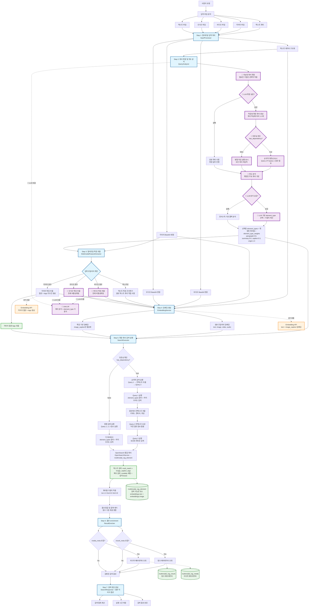
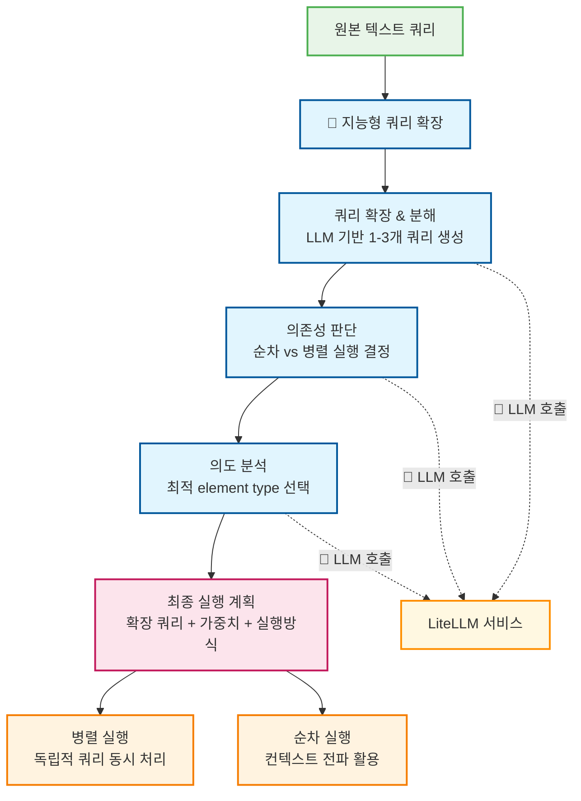
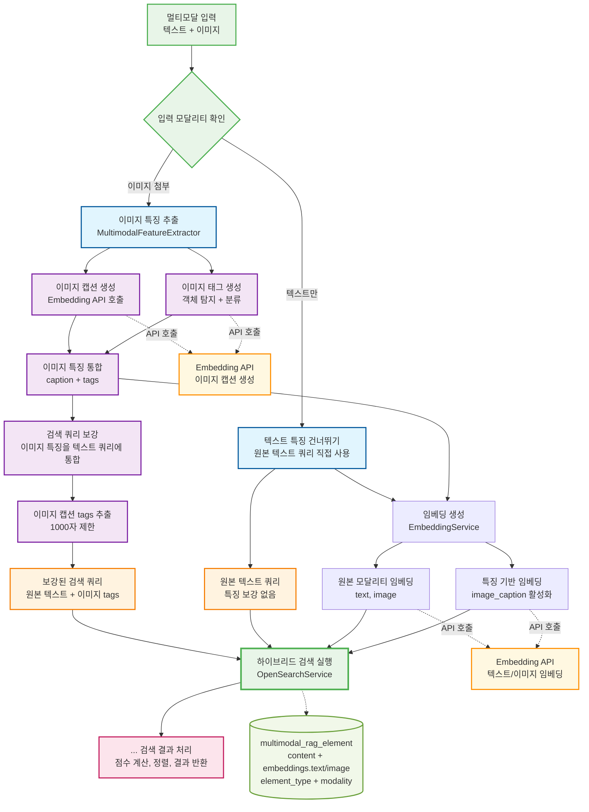
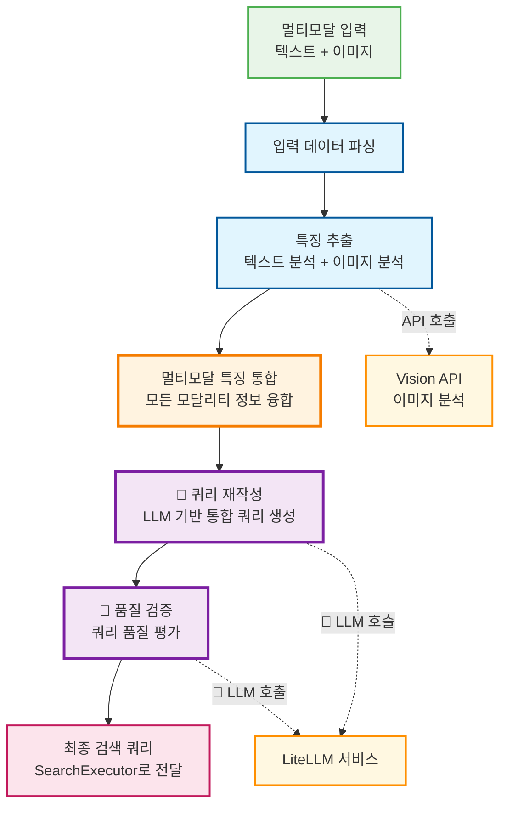
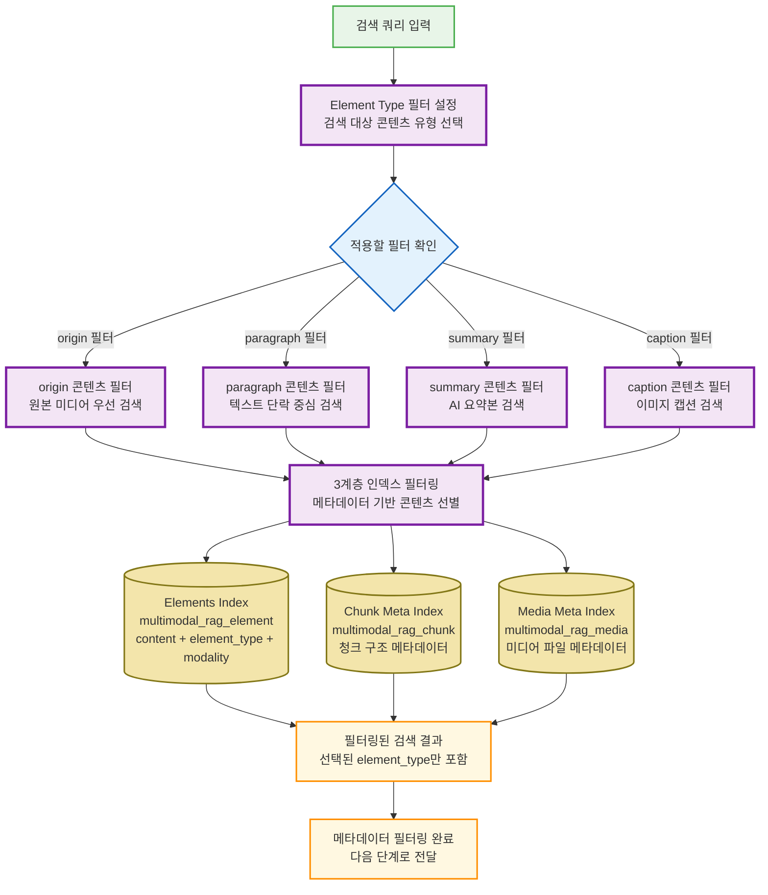
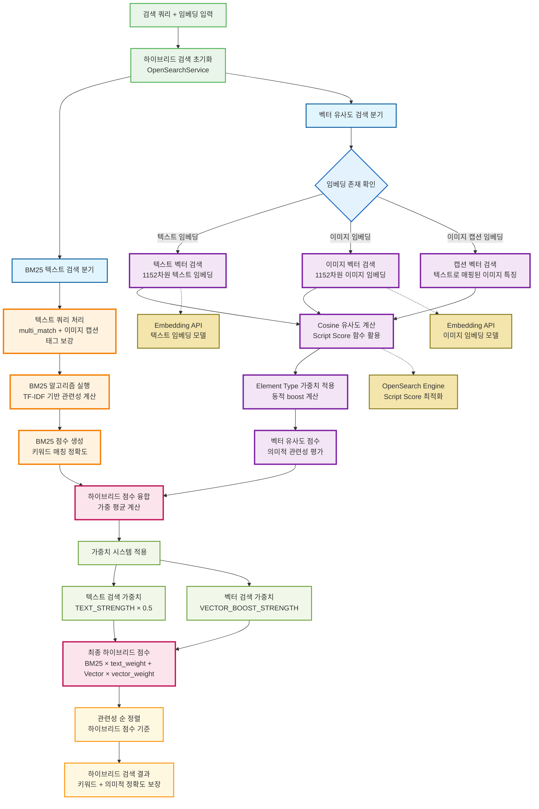
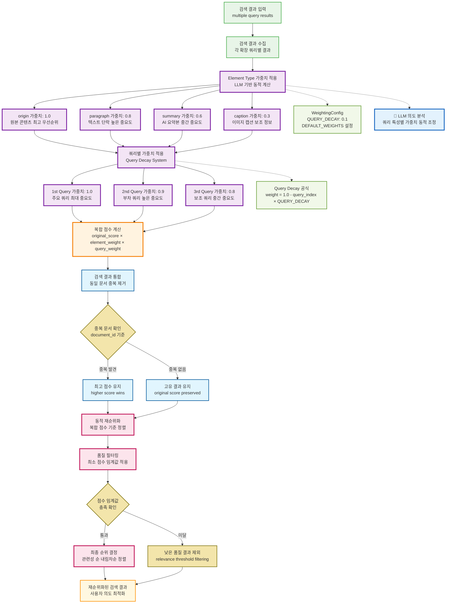
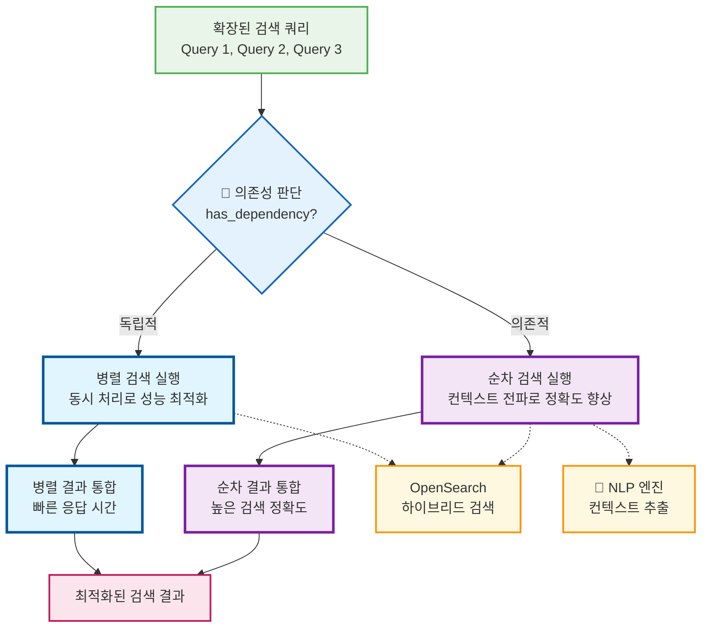
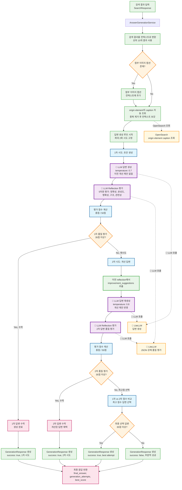

## 시스템 아키텍처

### 1. 멀티모달 검색 파이프라인

### 2. 지능형 쿼리 확장 파이프라인

### 3. 모달리티별 특징 보강 하이브리드 검색 파이프라인

### 4. 멀티모달 통합 및 쿼리 재작성 파이프라인

### 5. 메타데이터 기반 필터링 시스템 파이프라인

메타데이터 기반 필터링 시스템은 OpenSearch의 3계층 인덱스 구조를 활용하여 체계적이고 효율적인 검색을 제공합니다. BM25 알고리즘과 한국어-영어 복합 분석기를 통해 정확한 키워드 매칭과 의미적 검색이 가능하며, element_type별 동적 가중치 시스템으로 검색 결과의 관련성을 최적화합니다.

이 시스템의 핵심은 사용자 쿼리의 의도에 따라 적절한 콘텐츠 유형만을 선별적으로 검색하는 지능형 필터링 메커니즘입니다. 예를 들어, 원본 이미지나 문서를 찾고자 할 때는 origin 필터를, 요약 정보가 필요할 때는 summary 필터를 적용하여 검색 정확도를 크게 향상시킵니다. 또한 3계층 인덱스 구조(Elements, Chunk Meta, Media Meta)를 통해 콘텐츠 레벨부터 파일 메타데이터까지 다층적 정보를 체계적으로 관리하며, 각 element_type별로 차등화된 가중치(origin 1.0, paragraph 0.8, summary 0.6, caption 0.3)를 적용하여 콘텐츠의 중요도에 따른 우선순위 검색을 지원합니다.

### 6. 하이브리드 검색 (BM25 + 벡터 유사도) 구현 파이프라인

하이브리드 검색 시스템은 전통적인 키워드 기반 검색(BM25)과 최신 벡터 유사도 검색을 결합하여 검색 정확도와 의미적 이해를 동시에 향상시킵니다. 이 시스템은 텍스트와 이미지 임베딩을 통합하여 멀티모달 검색을 지원하며, 동적 가중치 시스템을 통해 각 검색 방법의 기여도를 최적화합니다.

#### 주요 구성 요소:
- **BM25 텍스트 검색**: TF-IDF 기반 키워드 관련성 평가, 정확한 용어 매칭 보장
- **벡터 유사도 검색**: 텍스트 및 이미지 임베딩 모델을 활용한 의미적 유사도 계산
- **모달리티별 임베딩**: 텍스트(1152차원), 이미지(1152차원) 벡터 통합
- **동적 가중치 조절**: TEXT_STRENGTH와 VECTOR_BOOST를 통한 검색 균형 조정
- **Script Score 최적화**: OpenSearch 내장 함수를 활용한 고성능 벡터 연산

#### 단계별 세부 내용:

**1. 검색 초기화 단계**
- 입력된 텍스트 쿼리와 멀티모달 임베딩을 분석하여 하이브리드 검색 전략 수립
- 사용 가능한 임베딩 모달리티(텍스트, 이미지, 캡션) 확인 및 검색 분기 결정

**2. BM25 텍스트 검색**
- `multi_match` 쿼리를 통한 정확한 키워드 매칭 수행
- 이미지 캡션 태그를 텍스트 쿼리에 자동 통합하여 검색 범위 확장
- TF-IDF 알고리즘 기반 문서 관련성 점수 계산 및 정규화

**3. 벡터 유사도 검색**
- 외부 Embedding API를 통한 텍스트 및 이미지 1152차원 벡터 생성
- OpenSearch Script Score 함수를 통한 고성능 코사인 유사도 계산
- Element Type별 동적 가중치를 벡터 검색에 실시간 적용

**4. 하이브리드 점수 융합**
- BM25와 벡터 점수를 가중 평균으로 통합하여 균형잡힌 검색 결과 생성
- `TEXT_STRENGTH`와 `VECTOR_BOOST_STRENGTH` 설정을 통한 검색 방법별 기여도 조절
- 최종 하이브리드 점수 = (BM25 × 텍스트 가중치) + (벡터 × 벡터 가중치)

### 7. 동적 가중치 시스템을 통한 검색결과 재순위화 파이프라인

동적 가중치 시스템은 사용자 쿼리의 의도와 콘텐츠 특성을 분석하여 실시간으로 가중치를 조정하고 검색 결과를 재순위화합니다. 이 시스템은 Element Type별 중요도, 쿼리별 우선순위, 모달리티별 기여도를 종합적으로 고려하여 사용자에게 최적화된 검색 결과를 제공합니다.

#### 단계별 세부 내용:

**1. Element Type 가중치 시스템**
- **LLM 기반 동적 계산**: 사용자 쿼리 의도를 분석하여 콘텐츠 유형별 중요도 실시간 조정
- **계층적 가중치 구조**: origin(1.0) → paragraph(0.8) → summary(0.6) → caption(0.3) 순차적 중요도 적용
- **의도 맞춤 조정**: 원본 자료 검색 시 origin 강화, 요약 정보 검색 시 summary 강화

**LLM 기반 쿼리 의도 분석**
- **의미적 분석**: 쿼리의 핵심 키워드와 문맥을 분석하여 사용자가 찾고자 하는 콘텐츠 유형 예측
- **의도 분류**: 정보 탐색(information seeking), 자료 확인(fact checking), 요약 요청(summarization), 시각 자료(visual content) 등으로 구분
- **자동 가중치 조절**: 분석된 의도에 따라 element_type별 가중치를 자동으로 재계산하여 검색 정확도 향상
- **예시**: "상세한 내용을 알려줘" → paragraph 가중치 증가, "요약해줘" → summary 가중치 증가, "원본 문서 보여줘" → origin 가중치 증가

**Element Type별 자동 가중치 조절 메커니즘**
- **실시간 프롬프트 엔지니어링**: 쿼리 텍스트를 LLM에 전달하여 의도 분석 결과를 JSON 형태로 수신
- **가중치 매핑 테이블**: 분석된 의도를 기반으로 각 element_type의 boost 값을 0.1~2.0 범위 내에서 자동 계산
- **폴백 메커니즘**: LLM 분석 실패 시 휴리스틱 기반 기본 가중치(origin:1.0, paragraph:0.8, summary:0.6, caption:0.3) 적용
- **가중치 정규화**: 계산된 가중치들을 정규화하여 검색 결과의 일관성 보장
- **캐싱 최적화**: 동일한 쿼리 패턴에 대한 의도 분석 결과를 캐싱하여 응답 속도 개선

**2. Query Decay System**
- **순차적 가중치 감소**: 1st(1.0) → 2nd(0.9) → 3rd(0.8)로 쿼리 순서별 중요도 차등 적용
- **QUERY_DECAY 설정**: 기본값 0.1로 각 쿼리 간 10% 가중치 감소 적용
- **확장 쿼리 우선순위**: 주요 쿼리를 최우선으로 하여 검색 정확도 보장

**3. 복합 점수 계산**
- **다차원 가중치 융합**: original_score × element_weight × query_weight 공식 적용
- **정규화 처리**: 서로 다른 검색 알고리즘(BM25, 벡터) 점수의 일관성 있는 통합
- **동적 boost 적용**: 실시간 쿼리 분석 결과에 따른 추가 가중치 부여

**4. 중복 제거 및 결과 통합**
- **document_id 기준 중복 검출**: 동일 문서가 여러 쿼리에서 검색된 경우 식별
- **최고 점수 보존**: 중복 문서 중 가장 높은 복합 점수를 가진 결과만 유지
- **고유 결과 보존**: 중복되지 않은 결과는 원본 점수와 메타데이터 모두 보존

**5. 품질 기반 최종 재순위화**
- **관련성 임계값 필터링**: 최소 품질 기준 미달 결과 자동 제외
- **사용자 의도 최적화**: 쿼리 분석 결과를 반영한 개인화된 순위 조정
- **일관성 있는 정렬**: 복합 점수 기준 내림차순으로 최종 검색 결과 제공

### 8. 다단계 검색 실행 최적화: 순차/병렬 처리 파이프라인

다단계 검색 실행 시스템은 LLM이 분석한 쿼리 간 의존성을 기반으로 최적의 실행 전략을 자동 선택합니다. 독립적인 쿼리들은 병렬 처리로 성능을 최대화하고, 의존적인 쿼리들은 순차 처리로 컨텍스트 전파를 통한 정확도를 향상시킵니다.

#### 처리 방식별 상세 분석:

**병렬 처리 (Independent Parallel Processing)**
- **적용 조건**: 쿼리 간 의존성이 없는 경우 (has_dependency = false)
- **실행 방식**: asyncio.gather()를 통한 동시 비동기 처리
- **성능 이점**: 
  - 응답 시간 단축 (순차 대비 최대 60-70% 단축)
  - CPU/메모리 자원의 효율적 활용
  - 높은 처리량으로 동시 다중 검색 지원
- **최적 시나리오**: "파이썬 기초", "데이터 분석", "머신러닝" 등 독립적 주제 검색

**순차 처리 (Context-aware Sequential Processing)**
- **적용 조건**: 쿼리 간 의존성이 있는 경우 (has_dependency = true)  
- **실행 방식**: 이전 결과 → 컨텍스트 추출 → 다음 쿼리 보강 → 실행
- **정확도 이점**:
  - 컨텍스트 전파를 통한 검색 정확도 15-20% 향상
  - 의미적 연관성 강화로 관련성 높은 결과 우선 제공
  - 점진적 정보 축적을 통한 포괄적 검색 결과
- **최적 시나리오**: "최신 라이브러리" → "설치 방법" → "사용 예제" 등 단계적 정보 탐색

**컨텍스트 전파 메커니즘**
- **키워드 추출**: 이전 검색 결과에서 핵심 키워드 자동 식별
- **엔티티 인식**: 인명, 기술명, 제품명 등 중요 엔티티 추출 및 활용
- **의미적 확장**: 관련 개념과 동의어를 다음 쿼리에 자동 포함
- **가중치 조정**: 컨텍스트 정보의 중요도에 따른 동적 boost 적용

### 9. LLM 답변 생성 파이프라인

