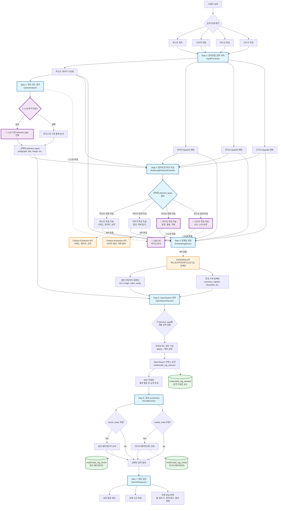

# Multimodal Search & RAG System

## 프로젝트 개요

OpenSearch를 사용한 멀티모달 검색 및 RAG 시스템입니다. 텍스트, 이미지, 비디오, 오디오를 통합하여 검색하고, 하이브리드 검색(BM25 + 벡터 검색)과 LLM 기반 질의 분석을 지원합니다.

## 검색 파이프라인 플로우



## 주요 특징

- **멀티모달 입력**: 텍스트, 이미지, 비디오, 오디오 동시 지원
- **하이브리드 검색**: BM25 텍스트 검색 + 벡터 유사도 검색
- **LLM 기반 질의 분석**: 검색 의도 파악 및 최적 element type 선택
- **3계층 인덱스 구조**: media_meta, chunk_meta, elements로 체계적 관리
- **외부 API 통합**: Feature Extraction 및 Embedding API 활용

## 기술 스택

- **Backend**: FastAPI (Python 3.11+)
- **Package Manager**: uv + pyproject.toml
- **Search Engine**: OpenSearch (벡터 검색 지원)
- **LLM**: LiteLLM (다중 모델 지원)
- **External APIs**: Embedding & Feature Extraction Services
- **Deployment**: Docker + GitLab CI/CD

## 빠른 시작

### 1. 개발 환경 설정
```bash
# 의존성 설치
uv pip install -e .

# 개발 서버 실행
python run.py
```

### 2. Docker 실행
```bash
# 전체 서비스 실행
docker-compose up --build

# OpenSearch만 실행
docker-compose up opensearch opensearch-dashboards
```

### 3. API 테스트
- Demo 페이지: http://localhost:8000/demo
- API 문서: http://localhost:8000/docs

## 아키텍처

### 디렉토리 구조
```
app/
├── main.py              # FastAPI 애플리케이션
├── core/                # 설정 및 로깅
├── models/              # Pydantic 모델
├── services/            # 비즈니스 로직
│   ├── search/          # 검색 서비스
│   ├── embeddings/      # 임베딩 서비스  
│   ├── analysis/        # 분석 서비스
│   └── processing/      # 전처리 서비스
├── clients/             # 외부 API 클라이언트
└── api/routes/          # API 엔드포인트
```

### OpenSearch 인덱스 구조
1. **multimodal_rag_media**: 미디어 파일 메타데이터
2. **multimodal_rag_chunk**: 청크 구조 정보
3. **multimodal_rag_element**: 검색 가능한 요소 (임베딩 포함)

## 환경 변수 설정

`.env` 파일에 다음 설정이 필요합니다:

```bash
# OpenSearch
OPENSEARCH_HOST=localhost
OPENSEARCH_PORT=9200

# External APIs
EMBEDDING_API_URL=http://localhost:8080
FEATURE_EXTRACTION_API_URL=http://localhost:8081

# LLM
LITELLM_URL=http://localhost:4000
LITELLM_MODEL=gpt-4o-mini

# Logging
LOG_LEVEL=info
```

### 멀티모달 입력 지원

시스템은 다음과 같은 입력 조합을 지원합니다:
- 텍스트 + 이미지 + 비디오
- 텍스트 + 비디오  
- 텍스트 + 이미지
- 단일 모달리티 입력도 가능

### OpenSearch 인덱스 설계

#### 1. Media Meta 인덱스 (multimodal_rag_media)
미디어 파일의 기본 정보와 메타데이터를 저장하여 필터링 및 집계 기능을 제공합니다.

**주요 필드:**
- `media_id`: 기본키
- `media_type`: 비즈니스 도메인 분류 (video|audio|image|document)
- `file_size_bytes`, `duration_seconds`: 기본 메타데이터
- `width_pixels`, `height_pixels`: 해상도 정보
- `language_primary`: 언어 필터링
- `metadata_flat`: 확장 가능한 기술적 메타데이터 (flattened 타입)

#### 2. Chunk Meta 인덱스 (multimodal_rag_chunk)
미디어 내의 의미 단위 청크에 대한 구조적 정보를 제공합니다.

**주요 필드:**
- `chunk_id`: 기본키
- `media_id`: 부모 미디어 참조
- `chunk_seq`: 미디어 내 순서
- `chunk_type`: 청크 유형 (overview|section|scene|figure|table)
- `modality_set`: 포함된 모달리티 목록
- `element_count`: 포함된 요소 개수

#### 3. Element 인덱스 (multimodal_rag_element)
실제 검색이 수행되는 핵심 인덱스로, 벡터 검색과 텍스트 검색을 모두 지원합니다.

**주요 필드:**
- `element_id`: 기본키
- `chunk_id`, `media_id`: 계층 구조 참조
- `modality`: 모달리티 구분 (text|image|video|audio)
- `element_type`: 세부 유형 (summary|stt|caption|ocr|paragraph)
- `content`: 검색 대상 내용 (BM25 검색용)
- `embeddings`: 벡터 검색용 임베딩 (모달리티별)
- `quality_scores`: 품질 점수 (리랭킹용)

## 시스템 특징

### 계층적 결과 반환
- Element 검색 결과를 기준으로 상위 Chunk Meta와 Media Meta 정보 포함
- Element 점수 기준 정렬 유지
- Chunk/Media Meta 포함 여부는 요청 옵션으로 제어 가능

### LLM 기반 질의 분석
- 사용자 쿼리에서 적절한 element_type 선택
- 다중 element_type 선택 지원
- 휴리스틱 폴백 메커니즘 제공

### 고급 검색 기능
- Feature extraction 결과와 질의 분석 결과 통합
- RRF(Reciprocal Rank Fusion) 기반 리랭킹
- 하이브리드 검색으로 정확도 향상

### 로깅 시스템
- LLM 요청/응답 전체 로깅
- 디버그/운영 레벨 분리 (기본: info)
- 상세 성능 메트릭 제공

### 웹 인터페이스
- `/demo` 엔드포인트에서 검색 테스트 가능
- 실시간 멀티모달 검색 체험
- 결과 시각화 및 메타데이터 표시

## 개발 및 배포

### 코드 품질
```bash
# 코드 포맷팅
python -m isort app/
python -m pyright app/
```

### CI/CD
- GitLab CI를 통한 자동 빌드
- Docker 이미지 GitLab Container Registry 푸시
- 다단계 배포 파이프라인 지원

---

## 라이선스 및 기여

이 프로젝트는 멀티모달 검색 기술의 연구 및 개발 목적으로 작성되었습니다.
