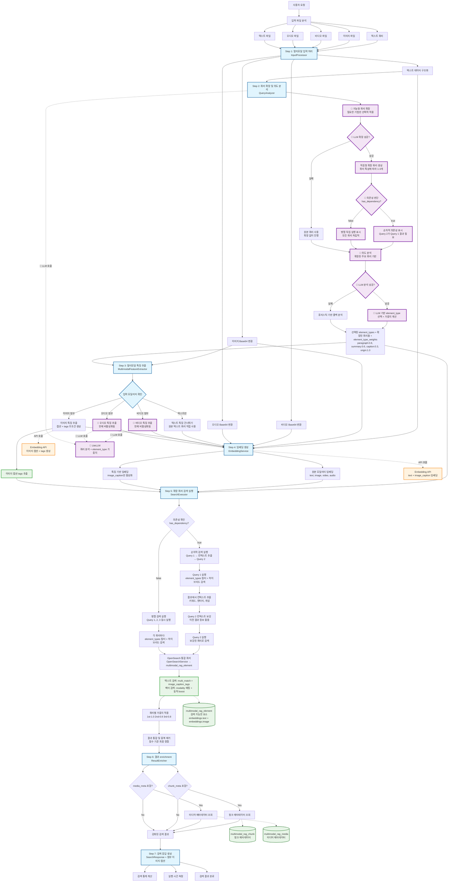
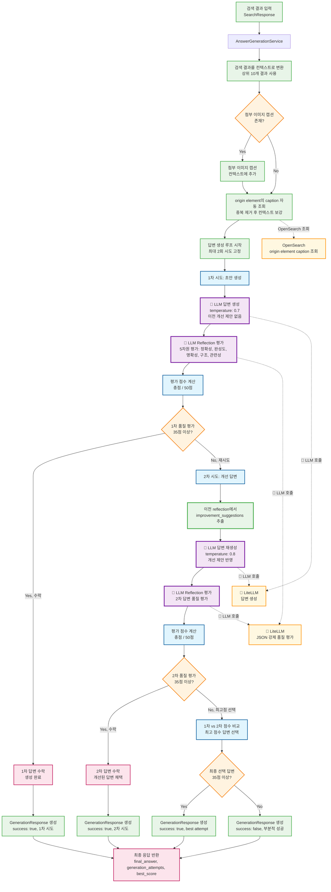

# Multimodal Search & RAG System

## 프로젝트 개요

OpenSearch를 사용한 멀티모달 검색 및 RAG 시스템입니다. 텍스트, 이미지, 비디오, 오디오를 통합하여 검색하고, 하이브리드 검색(BM25 + 벡터 검색)과 LLM 기반 질의 분석을 지원합니다.

## 시스템 아키텍처

### 1. 멀티모달 검색 파이프라인



### 2. LLM 답변 생성 파이프라인



## 주요 특징

### 멀티모달 검색 엔진
- **멀티모달 입력**: 텍스트, 이미지, 비디오, 오디오, 텍스트 파일 동시 지원
- **적응형 쿼리 확장**: 쿼리 특성에 따른 선택적 기법 적용 (Decomposition, Rewriting, Expansion)
- **지능형 의존성 처리**: LLM이 판단하는 순차/병렬 실행 방식 자동 선택
- **하이브리드 검색**: BM25 텍스트 검색 + 벡터 유사도 검색 + 이미지 캡션 태그 보강
- **LLM 기반 질의 분석**: 검색 의도 파악 및 최적 element type 선택 + 가중치 계산
- **이미지 캡션 태그 통합**: 이미지 캡션의 tags를 텍스트 검색 쿼리에 자동 추가 (1000자 제한)
- **동적 modality boost**: element_type_weights 기반 벡터 검색 가중치 동적 계산
- **간소화된 가중치 시스템**: 3개 핵심 설정으로 모든 세부 가중치 자동 계산

### AI 답변 생성 시스템
- **간소화된 2회 시도 시스템**: 초안 생성 → Reflection 평가 → 개선 제안 기반 재생성 (고정 2회)
- **5차원 품질 평가**: 정확성, 완성도, 명확성, 구조, 관련성 종합 평가 (총 50점)
- **첨부 이미지 지원**: 검색 결과와 첨부 이미지 캡션을 통합한 컨텍스트 생성
- **자동 캡션 보강**: origin element의 관련 caption 자동 조회 및 중복 제거
- **스트리밍 답변 생성**: 실시간 생성 과정 모니터링, 취소 가능, 시간 제한 (5분)
- **개선 제안 활용**: 이전 시도의 improvement_suggestions를 다음 시도에 반영

### 시스템 아키텍처
- **3계층 인덱스 구조**: media_meta, chunk_meta, elements로 체계적 관리
- **외부 API 통합**: Feature Extraction 및 Embedding API 활용
- **고급 예외 처리**: Circuit Breaker 패턴과 Retry Handler로 시스템 안정성 보장
- **보안 강화**: 민감 정보 마스킹 및 API 키 관리 시스템
- **병렬 처리 최적화**: 검색 및 임베딩 생성의 비동기 병렬 처리
- **외부 API 모니터링**: 실시간 외부 서비스 상태 체크 및 헬스 모니터링
- **스마트 로깅**: Base64 데이터 마스킹 및 노이즈 필터링으로 효율적인 디버깅
- **강화된 입력 검증**: 유연한 파일 시그니처 검증 및 XSS 방지

## 기술 스택

- **Backend**: FastAPI (Python 3.11+)
- **Package Manager**: uv + pyproject.toml
- **Search Engine**: OpenSearch (벡터 검색 지원)
- **LLM**: LiteLLM (다중 모델 지원)
- **External APIs**: Embedding & Feature Extraction Services
- **Deployment**: Docker + GitLab CI/CD

## ⚖️ 가중치 시스템

검색 정확도를 제어하는 핵심 시스템입니다. 사용자는 3개의 핵심 설정만 하면 됩니다.

### 핵심 사용자 설정 (3개)
- **WEIGHT_TEXT_STRENGTH** (0.0~1.0): 텍스트 검색 강도
- **WEIGHT_IMAGE_STRENGTH** (0.0~1.0): 이미지 검색 강도  
- **WEIGHT_VECTOR_BOOST_STRENGTH** (0.5~3.0): 벡터 검색 가중치

### 자동 계산되는 세부 가중치
- **Element Type별 가중치**: origin(1.0), paragraph(0.8), summary(0.6), caption(0.3)
- **쿼리별 가중치**: 1st(1.0), 2nd(0.9), 3rd(0.8) - QUERY_DECAY 기반
- **Modality Boost**: element_type_weights 기반 동적 계산 (0.5~2.0 범위)
- **텍스트/이미지 검색 균형**: 핵심 설정 기반 자동 조정

자세한 설정은 `app/core/config.py`의 WeightingConfig 참조

## 🚀 빠른 시작

### 1. 환경 설정
```bash
# 저장소 클론
git clone <repository-url>
cd multimodal-search

# 환경 변수 설정
cp .env.example .env
# .env 파일을 편집하여 실제 값으로 설정
```

### 2. 의존성 설치
```bash
# uv 패키지 매니저 사용 (권장)
uv pip install -e .

# 개발 의존성 포함
uv pip install -e .[dev]
```

### 3. 실행 방법

#### 로컬 개발 서버
```bash
# 개발 서버 실행
python run.py

# 또는 uvicorn 직접 실행
uvicorn app.main:app --reload --host 0.0.0.0 --port 8000
```

#### Docker 실행
```bash
# 전체 서비스 실행 (OpenSearch + App)
docker-compose up --build

# OpenSearch만 실행
docker-compose up opensearch opensearch-dashboards

# LiteLLM 포함 개발 환경
docker-compose --profile dev up
```

### 4. 접속 및 테스트
- **웹 데모**: http://localhost:8000/search
- **API 문서**: http://localhost:8000/docs
- **헬스체크**: http://localhost:8000/health
- **외부 API 상태**: http://localhost:8000/health/external-apis
- **OpenSearch 대시보드**: http://localhost:5601

#### API 엔드포인트
- **멀티모달 검색**: `POST /api/search/multimodal`
- **AI 답변 생성**: `POST /api/generation/multimodal`
- **스트리밍 검색+생성**: `POST /api/search/multimodal/stream`

## 아키텍처

### 디렉토리 구조
```
app/
├── main.py              # FastAPI 애플리케이션 (글로벌 예외 처리 미들웨어 포함)
├── core/                # 핵심 시스템 컴포넌트
│   ├── config.py        # 설정 관리
│   ├── logging.py       # 로깅 시스템 (스마트 필터링)
│   ├── security.py      # 보안 관리 (API 키 마스킹, 보안 유틸리티)
│   ├── exceptions.py    # 예외 처리 (Circuit Breaker, Retry Handler, 미들웨어)
│   ├── validators.py    # 강화된 입력 검증 (파일 시그니처, XSS 방지)
│   ├── dependencies.py  # 의존성 주입
│   └── index_mappings.py # OpenSearch 인덱스 매핑
├── models/              # Pydantic 모델
│   ├── opensearch.py    # 검색 관련 모델
│   ├── generation.py    # 답변 생성 관련 모델
│   └── features.py      # 특징 추출 모델
├── services/            # 비즈니스 로직 (병렬 처리 최적화)
│   ├── search/          # 검색 서비스 (병렬 쿼리 실행)
│   ├── generation/      # AI 답변 생성 서비스
│   ├── streaming/       # 스트리밍 통합 서비스
│   ├── embeddings/      # 임베딩 서비스 (병렬 임베딩 생성)
│   ├── analysis/        # 분석 서비스
│   └── processing/      # 전처리 서비스
├── clients/             # 외부 API 클라이언트 (보안 강화)
│   ├── llm_client.py    # LLM 클라이언트 (답변 생성용)
│   ├── embedding_client.py # 임베딩 API 클라이언트
│   └── feature_extraction_client.py # 특징 추출 API 클라이언트
└── api/routes/          # API 엔드포인트
    ├── search.py        # 검색 엔드포인트
    ├── generation.py    # 답변 생성 엔드포인트
    └── config.py        # 설정 엔드포인트
```

### OpenSearch 인덱스 구조
1. **multimodal_rag_media**: 미디어 파일 메타데이터
2. **multimodal_rag_chunk**: 청크 구조 정보
3. **multimodal_rag_element**: 검색 가능한 요소 (임베딩 포함)

## 환경 변수 설정

`.env` 파일에 다음 설정이 필요합니다:

```bash
# OpenSearch Configuration
OPENSEARCH_HOST=localhost
OPENSEARCH_PORT=9200
OPENSEARCH_USE_SSL=false
OPENSEARCH_VERIFY_CERTS=false
OPENSEARCH_USERNAME=admin
OPENSEARCH_PASSWORD=admin

# External API Configuration
EMBEDDING_API_URL=http://localhost:8080
FEATURE_EXTRACTION_API_URL=http://localhost:8081
MULTIMODAL_API_KEY=your-secure-api-key

# LiteLLM Configuration
LITELLM_URL=http://localhost:4000
LITELLM_API_KEY=your-secure-llm-key
LITELLM_MODEL=gpt-4o-mini

# Application Configuration
APP_HOST=127.0.0.1
APP_PORT=8000
LOG_LEVEL=info
DEBUG=false

# Storage Configuration
STORAGE_PATH=/storage
```

**보안 주의사항:**
- `.env` 파일은 이미 `.gitignore`에 추가되어 버전 관리에서 제외됩니다
- 프로덕션 환경에서는 환경 변수나 보안 관리 시스템을 사용하세요
- API 키는 절대 하드코딩하지 마세요

### 멀티모달 입력 지원
- 텍스트 + 이미지 + 비디오
- 텍스트 + 비디오/이미지
- 단일 모달리티 입력

### 쿼리 확장 예시
- **단순 쿼리**: "파이썬 튜토리얼" → "Python 가이드", "파이썬 프로그래밍 학습" (병렬 처리)
- **복합 쿼리**: "파이썬 머신러닝과 시각화" → 두 개념으로 분해 후 병렬 검색
- **의존 쿼리**: "최신 라이브러리와 사용법" → 1차 결과를 2차 쿼리에 반영하여 순차 처리

### OpenSearch 인덱스 설계

#### 3계층 인덱스 구조
1. **Media Meta**: 미디어 파일 메타데이터 (`media_id`, `media_type`, 파일 정보)
2. **Chunk Meta**: 청크 구조 정보 (`chunk_id`, `chunk_type`, 모달리티 정보)  
3. **Element**: 검색 대상 요소 (`element_id`, `content`, `embeddings`, 품질 점수)

## 시스템 특징

### 🔍 지능형 검색
- **적응형 쿼리 확장**: 쿼리 특성에 따른 선택적 기법 적용 (분해, 재작성, 의미 확장)
- **🆕 지능형 의존성 판단**: LLM이 쿼리 간 의존성을 자동 분석하여 실행 방식 결정
- **하이브리드 검색**: BM25 텍스트 검색 + 벡터 유사도 검색 결합
- **🆕 적응형 실행**: 독립적 쿼리는 병렬, 의존적 쿼리는 순차 처리
- **🆕 컨텍스트 보강**: 이전 검색 결과를 활용한 다음 쿼리 정확도 향상
- **폴백 메커니즘**: LLM 실패 시 원본 쿼리로 안정적 서비스 지속

### 🛡️ 시스템 안정성
- **Circuit Breaker**: 외부 API 장애 시 서비스 보호 및 빠른 복구
- **자동 재시도**: 지수 백오프를 통한 일시적 오류 극복
- **보안 강화**: API 키 마스킹 및 민감 정보 보호
- **글로벌 예외 처리**: 통합된 오류 처리 및 구조화된 응답

### ⚡ 성능 최적화
- **병렬 처리**: 임베딩 생성 및 메타데이터 조회 동시 실행
- **스마트 로깅**: 86% 볼륨 감소 및 Base64 데이터 마스킹
- **검색 로직 간소화**: 불필요한 리랭킹 과정 제거
- **실시간 모니터링**: 외부 API 상태 및 응답 시간 추적

## 주요 업데이트

### v0.3.2 - 간소화된 답변 생성 시스템 (현재)
- **🆕 고정 2회 시도 시스템**: 복잡한 재검색 로직 제거, 개선 제안 기반 재생성으로 단순화
- **🆕 첨부 이미지 통합**: 검색 결과와 첨부 이미지 캡션을 통합한 컨텍스트 생성
- **🆕 자동 캡션 보강**: origin element의 관련 caption 자동 조회 및 중복 제거
- **스트리밍 최적화**: 실시간 모니터링, 취소 가능, 5분 시간 제한
- **개선 제안 활용**: 이전 시도의 improvement_suggestions를 다음 시도에 반영

### v0.3.0 - AI 답변 생성 시스템
- **Reflection 기반 품질 관리**: 5차원 평가를 통한 답변 품질 보장 (총 50점)
- **품질 임계값**: 35점 이상 답변 수락, 이하 시 재생성 또는 최고점 선택
- **스트리밍 답변 생성**: 실시간 생성 과정 모니터링

### v0.2.0 - 지능형 검색 시스템  
- **LLM 기반 쿼리 분해**: 의존성 인식 순차/병렬 실행
- **컨텍스트 전파**: 이전 검색 결과 활용한 쿼리 보강
- **성능 최적화**: 86% 로깅 감소, Circuit Breaker 패턴

---

## 라이선스 및 기여

이 프로젝트는 멀티모달 검색 기술의 연구 및 개발 목적으로 작성되었습니다.
