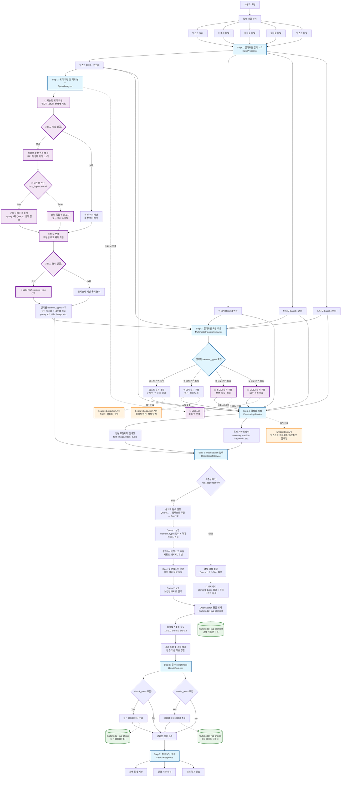
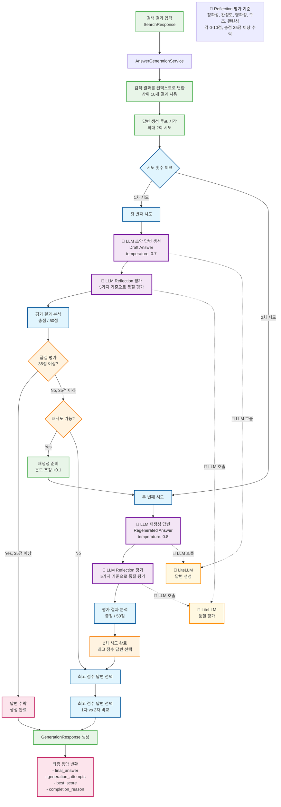

# Multimodal Search & RAG System

## 프로젝트 개요

OpenSearch를 사용한 멀티모달 검색 및 RAG 시스템입니다. 텍스트, 이미지, 비디오, 오디오를 통합하여 검색하고, 하이브리드 검색(BM25 + 벡터 검색)과 LLM 기반 질의 분석을 지원합니다.

## 시스템 아키텍처

### 1. 멀티모달 검색 파이프라인



### 2. LLM 답변 생성 파이프라인



## 주요 특징

### 멀티모달 검색 엔진
- **멀티모달 입력**: 텍스트, 이미지, 비디오, 오디오, 텍스트 파일 동시 지원
- **적응형 쿼리 확장**: 쿼리 특성에 따른 선택적 기법 적용 (Decomposition, Rewriting, Expansion)
- **지능형 의존성 처리**: LLM이 판단하는 순차/병렬 실행 방식 자동 선택
- **하이브리드 검색**: BM25 텍스트 검색 + 벡터 유사도 검색 + 확장 쿼리 통합
- **LLM 기반 질의 분석**: 검색 의도 파악 및 최적 element type 선택
- **컨텍스트 전파**: 이전 검색 결과를 활용한 다음 쿼리 보강
- **가중치 기반 결과 융합**: 확장된 쿼리별 가중치 적용 및 중복 제거

### AI 답변 생성 시스템
- **2단계 품질 보장**: 초안 생성 → Reflection 평가 → 재생성 (최대 2회)
- **5차원 품질 평가**: 정확성, 완성도, 명확성, 구조, 관련성 종합 평가
- **적응형 온도 조절**: 재생성 시 창의성 증가 (temperature +0.1)
- **점수 기반 수락**: 35점 이상 자동 수락, 미만 시 재생성 또는 최고 점수 선택
- **스트리밍 답변 생성**: 실시간 생성 과정 모니터링 및 취소 가능
- **컨텍스트 활용**: 검색 결과를 구조화된 컨텍스트로 변환하여 답변 생성

### 시스템 아키텍처
- **3계층 인덱스 구조**: media_meta, chunk_meta, elements로 체계적 관리
- **외부 API 통합**: Feature Extraction 및 Embedding API 활용
- **고급 예외 처리**: Circuit Breaker 패턴과 Retry Handler로 시스템 안정성 보장
- **보안 강화**: 민감 정보 마스킹 및 API 키 관리 시스템
- **병렬 처리 최적화**: 검색 및 임베딩 생성의 비동기 병렬 처리
- **외부 API 모니터링**: 실시간 외부 서비스 상태 체크 및 헬스 모니터링
- **스마트 로깅**: Base64 데이터 마스킹 및 노이즈 필터링으로 효율적인 디버깅
- **강화된 입력 검증**: 유연한 파일 시그니처 검증 및 XSS 방지

## 기술 스택

- **Backend**: FastAPI (Python 3.11+)
- **Package Manager**: uv + pyproject.toml
- **Search Engine**: OpenSearch (벡터 검색 지원)
- **LLM**: LiteLLM (다중 모델 지원)
- **External APIs**: Embedding & Feature Extraction Services
- **Deployment**: Docker + GitLab CI/CD

## ⚖️ 가중치 시스템 (Weight System)

멀티모달 검색의 정확도와 관련성을 제어하는 핵심 시스템입니다. 모든 가중치는 환경변수로 설정 가능합니다.

### 📊 Element Type별 가중치

검색 대상이 되는 콘텐츠 타입별 중요도를 설정합니다:

| Element Type | 설명 | 기본 가중치 | 환경변수 |
|-------------|------|-----------|---------|
| **origin** | 원본 이미지 | 1.0 | `WEIGHT_ORIGIN_DEFAULT` |
| **paragraph** | 일반 문단 (본문) | 0.8 | `WEIGHT_PARAGRAPH_DEFAULT` |
| **summary** | AI 요약문 | 0.6 | `WEIGHT_SUMMARY_DEFAULT` |
| **caption** | 이미지 캡션 | 0.3 | `WEIGHT_CAPTION_DEFAULT` |

### 🔗 쿼리별 가중치

여러 확장 쿼리의 중요도를 조절합니다:

```
첫 번째 쿼리: 1.0 (원본 쿼리)
두 번째 쿼리: 0.9 (확장 쿼리)
세 번째 쿼리: 0.8 (추가 확장)
```

**설정**: `WEIGHT_QUERY_DECAY=0.1` (각 쿼리마다 0.1씩 감소)

### 🎯 동적 가중치 계산

쿼리 내용에 따라 가중치가 자동으로 조정됩니다:

#### 텍스트 검색 예시
```
쿼리: "문서 요약해주세요"
→ summary: 0.9 (요약 키워드 감지로 상승)
→ paragraph: 0.6 (상대적으로 감소)
```

#### 이미지 검색 예시
```
쿼리: "헤드폰 이미지" + 이미지 첨부
→ origin: 1.0 (이미지 자체가 최우선)
→ caption: 0.2 (보조 정보)
→ paragraph: 0.0 (검색에서 제외)
```

### 🔧 커스터마이징

`.env` 파일에서 가중치를 조정할 수 있습니다:

```env
# 이미지 검색 강화
WEIGHT_IMAGE_ORIGIN=1.0
WEIGHT_IMAGE_CAPTION_BASE=0.5

# 본문 중심 검색
WEIGHT_TEXT_PARAGRAPH_DEFAULT=0.9
WEIGHT_TEXT_SUMMARY_DEFAULT=0.4

# 원본 쿼리 중심 (확장 효과 감소)
WEIGHT_QUERY_DECAY=0.2
```

### 📈 성능 튜닝 가이드

**정확도 향상**: 관련성 높은 타입의 가중치 증가
**다양성 증가**: 여러 타입에 균등한 가중치 부여  
**속도 개선**: 불필요한 타입은 0.0으로 제외

> 💡 **자세한 설명**: `app/core/config.py`의 `WeightingConfig` 클래스 docstring 참조

## 🚀 빠른 시작

### 1. 환경 설정
```bash
# 저장소 클론
git clone <repository-url>
cd multimodal-search

# 환경 변수 설정
cp .env.example .env
# .env 파일을 편집하여 실제 값으로 설정
```

### 2. 의존성 설치
```bash
# uv 패키지 매니저 사용 (권장)
uv pip install -e .

# 개발 의존성 포함
uv pip install -e .[dev]
```

### 3. 실행 방법

#### 로컬 개발 서버
```bash
# 개발 서버 실행
python run.py

# 또는 uvicorn 직접 실행
uvicorn app.main:app --reload --host 0.0.0.0 --port 8000
```

#### Docker 실행
```bash
# 전체 서비스 실행 (OpenSearch + App)
docker-compose up --build

# OpenSearch만 실행
docker-compose up opensearch opensearch-dashboards

# LiteLLM 포함 개발 환경
docker-compose --profile dev up
```

### 4. 접속 및 테스트
- **웹 데모**: http://localhost:8000/search
- **API 문서**: http://localhost:8000/docs
- **헬스체크**: http://localhost:8000/health
- **외부 API 상태**: http://localhost:8000/health/external-apis
- **OpenSearch 대시보드**: http://localhost:5601

#### API 엔드포인트
- **멀티모달 검색**: `POST /api/search/multimodal`
- **AI 답변 생성**: `POST /api/generation/multimodal`
- **스트리밍 검색**: `GET /api/search/multimodal/stream`

## 아키텍처

### 디렉토리 구조
```
app/
├── main.py              # FastAPI 애플리케이션 (글로벌 예외 처리 미들웨어 포함)
├── core/                # 핵심 시스템 컴포넌트
│   ├── config.py        # 설정 관리
│   ├── logging.py       # 로깅 시스템 (스마트 필터링)
│   ├── security.py      # 보안 관리 (API 키 마스킹, 보안 유틸리티)
│   ├── exceptions.py    # 예외 처리 (Circuit Breaker, Retry Handler, 미들웨어)
│   ├── validators.py    # 강화된 입력 검증 (파일 시그니처, XSS 방지)
│   ├── dependencies.py  # 의존성 주입
│   └── index_mappings.py # OpenSearch 인덱스 매핑
├── models/              # Pydantic 모델
│   ├── opensearch.py    # 검색 관련 모델
│   ├── generation.py    # 답변 생성 관련 모델
│   └── features.py      # 특징 추출 모델
├── services/            # 비즈니스 로직 (병렬 처리 최적화)
│   ├── search/          # 검색 서비스 (병렬 쿼리 실행)
│   ├── generation/      # AI 답변 생성 서비스
│   ├── streaming/       # 스트리밍 통합 서비스
│   ├── embeddings/      # 임베딩 서비스 (병렬 임베딩 생성)
│   ├── analysis/        # 분석 서비스
│   └── processing/      # 전처리 서비스
├── clients/             # 외부 API 클라이언트 (보안 강화)
│   ├── llm_client.py    # LLM 클라이언트 (답변 생성용)
│   ├── embedding_client.py # 임베딩 API 클라이언트
│   └── feature_extraction_client.py # 특징 추출 API 클라이언트
└── api/routes/          # API 엔드포인트
    ├── search.py        # 검색 엔드포인트
    ├── generation.py    # 답변 생성 엔드포인트
    └── config.py        # 설정 엔드포인트
```

### OpenSearch 인덱스 구조
1. **multimodal_rag_media**: 미디어 파일 메타데이터
2. **multimodal_rag_chunk**: 청크 구조 정보
3. **multimodal_rag_element**: 검색 가능한 요소 (임베딩 포함)

## 환경 변수 설정

`.env` 파일에 다음 설정이 필요합니다:

```bash
# OpenSearch Configuration
OPENSEARCH_HOST=localhost
OPENSEARCH_PORT=9200
OPENSEARCH_USE_SSL=false
OPENSEARCH_VERIFY_CERTS=false
OPENSEARCH_USERNAME=admin
OPENSEARCH_PASSWORD=admin

# External API Configuration
EMBEDDING_API_URL=http://localhost:8080
FEATURE_EXTRACTION_API_URL=http://localhost:8081
MULTIMODAL_API_KEY=your-secure-api-key

# LiteLLM Configuration
LITELLM_URL=http://localhost:4000
LITELLM_API_KEY=your-secure-llm-key
LITELLM_MODEL=gpt-4o-mini

# Application Configuration
APP_HOST=127.0.0.1
APP_PORT=8000
LOG_LEVEL=info
DEBUG=false

# Storage Configuration
STORAGE_PATH=/storage
```

**보안 주의사항:**
- `.env` 파일은 이미 `.gitignore`에 추가되어 버전 관리에서 제외됩니다
- 프로덕션 환경에서는 환경 변수나 보안 관리 시스템을 사용하세요
- API 키는 절대 하드코딩하지 마세요

### 멀티모달 입력 지원

시스템은 다음과 같은 입력 조합을 지원합니다:
- 텍스트 + 이미지 + 비디오
- 텍스트 + 비디오  
- 텍스트 + 이미지
- 단일 모달리티 입력도 가능

### 적응형 쿼리 확장 예시

**단순 쿼리 ("파이썬 튜토리얼")**:
```
적용 기법: Rewriting, Semantic Expansion
분해 여부: ⏭️ 건너뜀 (단일 개념)
의존성: has_dependency = false (독립적)
확장 결과:
  1. "Python 가이드" (재작성)
  2. "파이썬 프로그래밍 학습" (의미 확장)
실행 방식: 병렬 처리
```

**복합 독립 쿼리 ("파이썬 머신러닝과 데이터 시각화")**:
```
적용 기법: Decomposition, Rewriting, Semantic Expansion  
분해 결과: "파이썬 머신러닝" + "데이터 시각화"
의존성: has_dependency = false (각각 독립적)
확장 결과:
  1. "Python scikit-learn pandas" (기법별 통합)
  2. "머신러닝 모델 시각화" (의미 확장)
  3. "데이터 분석 차트 그래프" (관련 개념)
실행 방식: 병렬 처리
```

**복합 의존 쿼리 ("최신 파이썬 라이브러리와 그 사용법")**:
```
적용 기법: Decomposition, Rewriting, Semantic Expansion
분해 결과: "최신 파이썬 라이브러리" + "사용법"
의존성: has_dependency = true (Query 2가 Query 1 결과 필요)
확장 결과:
  1. "최신 Python 라이브러리 2024" (1차 쿼리)
  2. "파이썬 라이브러리 사용법" (2차 쿼리 - 컨텍스트로 보강될 예정)
실행 방식: 순차적 처리
  - Query 1 실행 → "FastAPI, Pandas, NumPy" 발견
  - Query 2를 "파이썬 라이브러리 사용법 FastAPI Pandas NumPy"로 보강하여 실행
```

**구체적 쿼리 ("Matplotlib pyplot.show() 함수")**:
```
적용 기법: Rewriting만
분해 여부: ⏭️ 건너뜀 (구체적 검색)
의미 확장: ⏭️ 건너뜀 (정확한 매칭 중요)
의존성: has_dependency = false (단일 쿼리)
확장 결과:
  1. "Matplotlib show 메서드" (표현 변경)
실행 방식: 단일 실행
```

### OpenSearch 인덱스 설계

#### 1. Media Meta 인덱스 (multimodal_rag_media)
미디어 파일의 기본 정보와 메타데이터를 저장하여 필터링 및 집계 기능을 제공합니다.

**주요 필드:**
- `media_id`: 기본키
- `media_type`: 비즈니스 도메인 분류 (video|audio|image|document)
- `file_size_bytes`, `duration_seconds`: 기본 메타데이터
- `width_pixels`, `height_pixels`: 해상도 정보
- `language_primary`: 언어 필터링
- `metadata_flat`: 확장 가능한 기술적 메타데이터 (flattened 타입)

#### 2. Chunk Meta 인덱스 (multimodal_rag_chunk)
미디어 내의 의미 단위 청크에 대한 구조적 정보를 제공합니다.

**주요 필드:**
- `chunk_id`: 기본키
- `media_id`: 부모 미디어 참조
- `chunk_seq`: 미디어 내 순서
- `chunk_type`: 청크 유형 (overview|section|scene|figure|table)
- `modality_set`: 포함된 모달리티 목록
- `element_count`: 포함된 요소 개수

#### 3. Element 인덱스 (multimodal_rag_element)
실제 검색이 수행되는 핵심 인덱스로, 벡터 검색과 텍스트 검색을 모두 지원합니다.

**주요 필드:**
- `element_id`: 기본키
- `chunk_id`, `media_id`: 계층 구조 참조
- `modality`: 모달리티 구분 (text|image|video|audio)
- `element_type`: 세부 유형 (summary|stt|caption|ocr|paragraph)
- `content`: 검색 대상 내용 (BM25 검색용)
- `embeddings`: 벡터 검색용 임베딩 (모달리티별)
- `quality_scores`: 품질 점수 (리랭킹용)

## 시스템 특징

### 🔍 지능형 검색
- **적응형 쿼리 확장**: 쿼리 특성에 따른 선택적 기법 적용 (분해, 재작성, 의미 확장)
- **🆕 지능형 의존성 판단**: LLM이 쿼리 간 의존성을 자동 분석하여 실행 방식 결정
- **하이브리드 검색**: BM25 텍스트 검색 + 벡터 유사도 검색 결합
- **🆕 적응형 실행**: 독립적 쿼리는 병렬, 의존적 쿼리는 순차 처리
- **🆕 컨텍스트 보강**: 이전 검색 결과를 활용한 다음 쿼리 정확도 향상
- **폴백 메커니즘**: LLM 실패 시 원본 쿼리로 안정적 서비스 지속

### 🛡️ 시스템 안정성
- **Circuit Breaker**: 외부 API 장애 시 서비스 보호 및 빠른 복구
- **자동 재시도**: 지수 백오프를 통한 일시적 오류 극복
- **보안 강화**: API 키 마스킹 및 민감 정보 보호
- **글로벌 예외 처리**: 통합된 오류 처리 및 구조화된 응답

### ⚡ 성능 최적화
- **병렬 처리**: 임베딩 생성 및 메타데이터 조회 동시 실행
- **스마트 로깅**: 86% 볼륨 감소 및 Base64 데이터 마스킹
- **검색 로직 간소화**: 불필요한 리랭킹 과정 제거
- **실시간 모니터링**: 외부 API 상태 및 응답 시간 추적

## 최근 업데이트 (v0.3.0)

### AI 답변 생성 시스템 추가
- **새로운 답변 생성 서비스**: 검색 결과를 기반으로 한 지능형 답변 생성
- **Reflection 기반 품질 관리**: 5차원 평가를 통한 답변 품질 보장
- **최대 2회 재생성**: 초안 → 평가 → 재생성 프로세스로 답변 품질 향상
- **스트리밍 답변 생성**: 실시간 생성 과정 모니터링 및 중간 취소 가능
- **통합 스트리밍 서비스**: 검색과 답변 생성의 완전한 통합 처리

### 이전 검색 시스템 개선사항 (v0.2.0)
- **지능형 Query Decomposition**: LLM이 판단하는 순차/병렬 실행 방식으로 검색 정확도 대폭 향상
- **컨텍스트 전파 시스템**: 이전 검색 결과를 활용한 다음 쿼리 보강으로 의존적 질의 처리 개선
- **성능 최적화**: 로깅 볼륨 86% 감소, 불필요한 코드 350줄 제거
- **시스템 안정성**: Circuit Breaker 패턴 및 재시도 메커니즘 도입
- **보안 강화**: API 키 마스킹, 파일 시그니처 검증 개선
- **코드 품질**: 미사용 코드 정리, 병렬 처리 최적화
- **모니터링**: 외부 API 헬스체크 및 성능 추적

### 새로운 기능
- **멀티모달 답변 생성**: 검색된 텍스트, 이미지, 비디오 정보를 종합한 AI 답변
- **품질 기반 재생성**: 35점 미만 답변 자동 재생성, 35점 이상 즉시 수락
- **실시간 생성 모니터링**: 초안 생성 → 품질 평가 → 재생성 과정 실시간 추적
- **답변 생성 API**: `/api/generation/multimodal` 엔드포인트 추가
- **의존성 인식 검색**: "최신 기술과 그 활용법" 같은 복합 쿼리에서 1차 결과를 2차 쿼리에 반영
- **적응형 실행 엔진**: 쿼리 특성에 따른 최적 실행 방식 자동 선택
- **컨텍스트 추출 알고리즘**: 검색 결과에서 키워드, 엔티티, 개념 자동 추출

### 삭제된 컴포넌트
- `RRFReranker` 클래스: 불필요한 리랭킹 과정 제거
- 미사용 임베딩 메서드들: 코드 복잡성 감소
- 과도한 로깅: 핵심 정보만 유지하여 디버깅 효율성 향상

---

## 라이선스 및 기여

이 프로젝트는 멀티모달 검색 기술의 연구 및 개발 목적으로 작성되었습니다.
